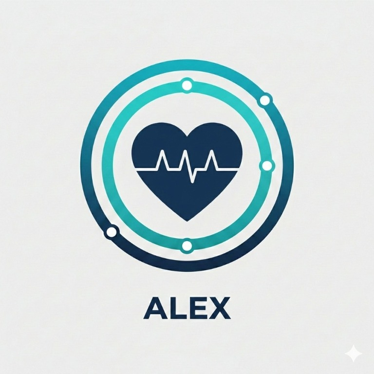

# Alex-rag

  

Alex-rag es una implementación independiente de un sistema **RAG** (*Retrieval-Augmented Generation*) orientado a consultas médicas e informativas de emergencias. Utiliza n8n para la orquestación, Ollama para la ejecución local de modelos y Discord como interfaz de comunicación.

> Alex-rag nació a partir del concepto general del proyecto ALEX, pero actualmente funciona de manera independiente. No está integrado con el backend principal de ALEX, y una posible integración futura no forma parte de su implementación actual.

## Propósito

- Ejecutar modelos de lenguaje localmente y reducir la dependencia de APIs externas.
- Mantener mayor control sobre el procesamiento y el almacenamiento de la información.
- Recuperar contexto relevante desde una base documental mediante arquitectura RAG.
- Facilitar consultas de texto a través de un bot de Discord.

El uso local de modelos no garantiza privacidad absoluta: esta también depende de la configuración de servicios, integraciones y almacenamiento.

## Características implementadas

- Infraestructura administrada con Docker Compose.
- n8n como motor de automatización y orquestación.
- Ollama con los modelos `llama3.2:3b`, `qwen2.5:3b` y `qwen3-embedding:0.6b`.
- Supabase para almacenamiento y recuperación vectorial, según la configuración operativa declarada por el proyecto.
- Memoria conversacional configurada dentro de los mecanismos disponibles en n8n.
- Bot de Discord como puente entre los usuarios y los webhooks de n8n.
- Qdrant definido como contenedor opcional con perfil `ia`; su uso activo debe verificarse en la configuración de los workflows.

## Arquitectura resumida

Discord recibe los mensajes del usuario y los envía al bot `discord-bot`. El bot selecciona el webhook configurado y llama a n8n. n8n orquesta la recuperación y la generación mediante los modelos disponibles en Ollama y el almacenamiento documental configurado. La documentación de los nodos y parámetros internos de los workflows se pospone hasta que se estabilice su configuración.

## Tecnologías principales

- [n8n](https://n8n.io/)
- [Ollama](https://ollama.com/)
- [Supabase](https://supabase.com/)
- [Discord](https://discord.com/) y discord.js
- [Docker](https://www.docker.com/) y Docker Compose
- [Nginx](https://nginx.org/)
- [Qdrant](https://qdrant.tech/) como componente opcional de infraestructura

## Estado del proyecto

La infraestructura básica, el bot de Discord y los mecanismos RAG configurados en n8n forman parte del estado actual. El RAG multiagente está previsto como objetivo futuro prioritario para mensajes de texto. La recepción y transcripción de audio mediante STT está contemplada únicamente como objetivo futuro.

## Documentación

Consulta el [índice de documentación](docs/README.md) para navegar por toda la información técnica.

- [Arquitectura general](docs/architecture/overview.md)
- [Docker y contenedores](docs/infrastructure/docker.md)
- [Nginx](docs/infrastructure/nginx.md)
- [Redes Docker](docs/infrastructure/networking.md)
- [Modelos Ollama](docs/ai/ollama-models.md)
- [Integración con Discord](docs/integrations/discord-bot.md)
- [Guía de despliegue](docs/deployment/deployment-guide.md)

